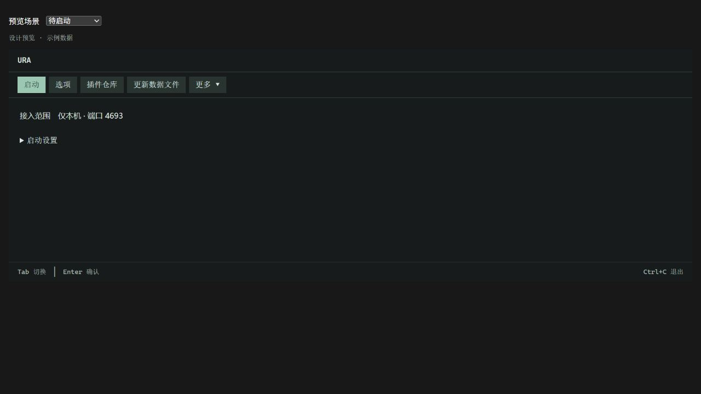
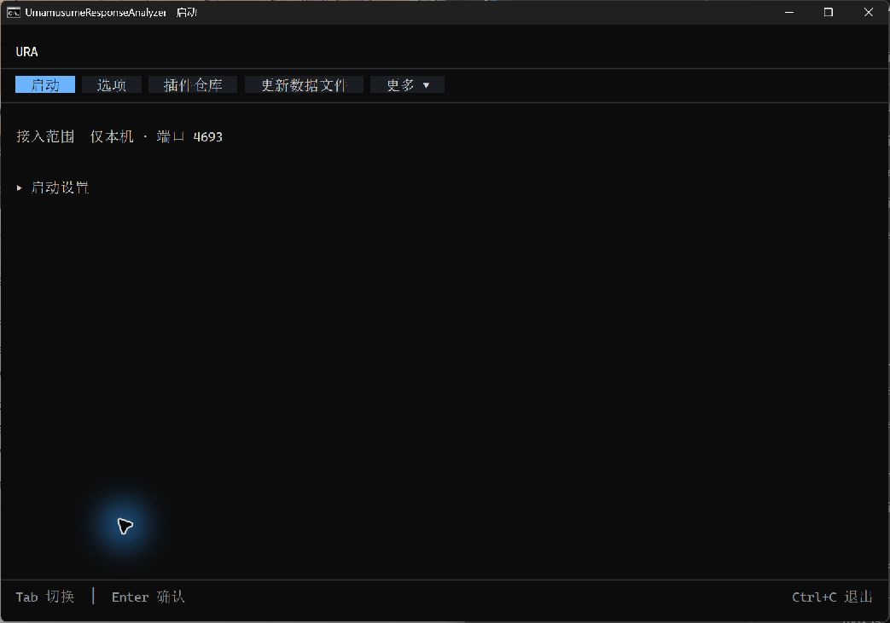
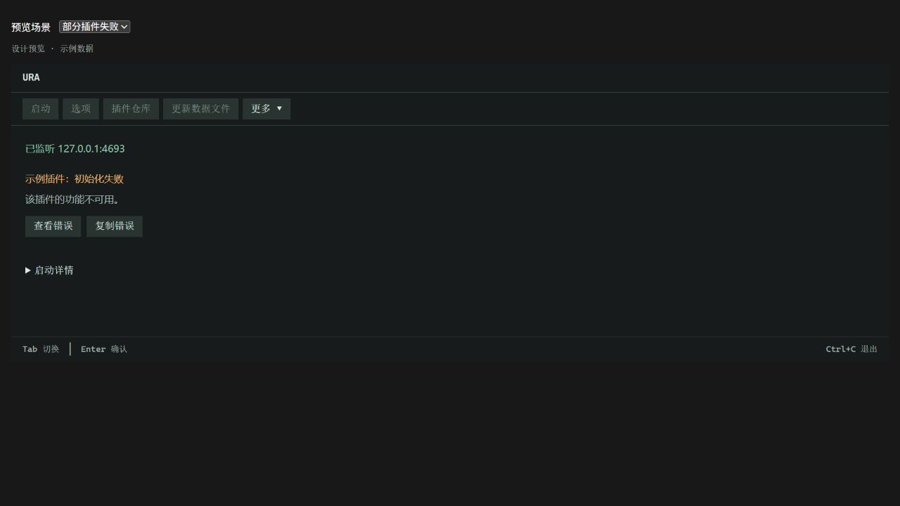
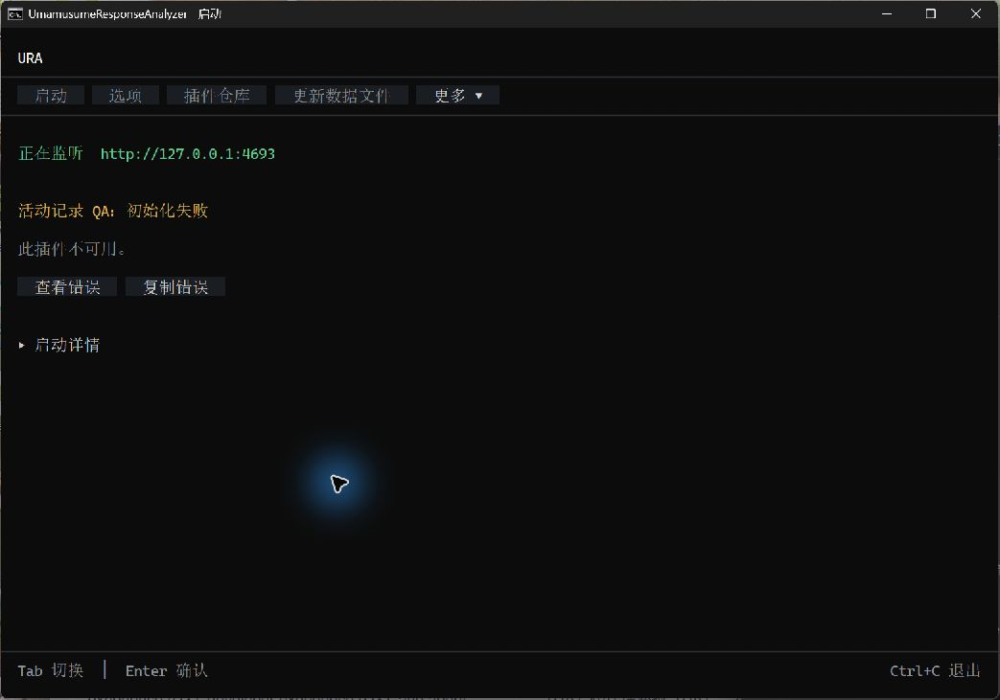

# Bootstrap workspace 设计验收

2026-10-27。**本轮验收完成：所列状态、尺寸及原生交互已实际检查。**

推荐窗口为 **120×35 字符**；本轮视觉验收范围为 **80×24～180×53**。范围外尺寸未作本次验收结论。

## 对照来源与环境

确认样稿为 `bootstrap-information-design.html`；参考图直接截自该交互样稿。原生截图使用当前产品的 `UiHost` / `BootstrapView`，运行于真实 Windows Console 和 Terminal.Gui 默认平台 driver。

截图中的配置、插件状态、监听结果与异常由隔离 QA fixture 提供，属于示例数据。截图程序没有真实开启 HTTP 服务或执行插件；业务启动、监听和插件生命周期另由 `StartupWorkflow` 等真实流程测试验证。

原生窗口沿用已批准的宿主蓝色主题，布局按字符格取整。最终截图在 `Application.Init` 后设置 **Cascadia Code 20px**，并核对原生窗口与 framebuffer 的字符布局。生产代码没有增加 16 色兼容处理。

隔离验收程序位于 Git 忽略的 `obj/bootstrap-visual-qa`，未引用测试程序集。样稿中的场景选择器和“设计预览 · 示例数据”标记属于预览工具，不进入产品。

## 同状态对照

| 状态 | 确认样稿 | 原生截图，120×35 |
| --- | --- | --- |
| 待启动 |  |  |
| 插件初始化失败 |  |  |

已核对标题、分隔线、工具栏顺序、正文对齐、折叠入口和底部快捷键。原生按钮使用单行高度并保留水平内边距；错误标题显示插件名和失败阶段，完整异常放在展开详情中。

## 状态与尺寸验收表

以下视觉结论来自原生窗口与截图；原生交互实测和业务流程测试分别记录。

| 状态或操作 | 对照要点 | 原生证据 | 当前判定 |
| --- | --- | --- | --- |
| 待启动，80×24 / 120×35 | 接入范围、端口、折叠启动设置；五个工具栏入口顺序固定 | [80×24](native-ready-80x24.png) · [120×35](native-ready-120x35.png) | 已确认 |
| 启动设置展开，120×35 / 80×24 | 监听绑定与数据语言按需显示，正文与底部提示完整 | [120×35](native-settings-120x35.png) · [80×24](native-settings-80x24.png) | 已确认 |
| 更多，120×35 | 原生菜单位于触发按钮下方，边框、选中项和四个入口清楚 | [更多](native-more-120x35.png) | 已确认 |
| 准备中，120×35 | 只显示当前准备阶段，启动操作尚未启用 | [准备中](native-preparing-120x35.png) | 已确认 |
| 启动中，80×24 | 显示当前阶段，启动前操作禁用，隐藏启动设置与详情 | [启动中](native-loading-80x24.png) | 已确认 |
| 监听成功，120×35 | 显示监听结果和折叠启动详情，不表示游戏已连接 | [监听成功](native-listening-120x35.png) | 已确认 |
| 无插件，80×24 | 明确插件功能不可用，保留启动入口；按 Enter 后进入监听示例状态 | [待启动](native-empty-80x24.png) · [启动后](native-empty-listening-80x24.png) | 已确认 |
| 插件初始化失败，120×35 | 监听结果保留；插件名、失败阶段、不可用影响及错误操作分层 | [初始化失败](native-partial-120x35.png) | 已确认，与失败样稿同状态 |
| 插件启动回调失败，120×35 | 标题为启动回调失败，影响说明插件仍活动 | [回调失败](native-callback-failure-120x35.png) | 已确认 |
| 展开并复制错误，80×24 | 详情与标题分开，复制反馈位于底部提示上方 | [错误详情与复制反馈](native-copy-80x24.png) | 已确认，系统剪贴板内容另行实测 |
| 数据失败，80×24 | 失败原因与退出后更新数据的下一步分层，不显示下游多项重复错误 | [数据失败](native-data-failure-80x24.png) | 已确认 |
| 监听失败，80×24 | 绑定失败及原因清楚，保留查看、复制错误入口 | [监听失败](native-bind-failure-80x24.png) | 已确认 |
| 浏览历史日志时后台追加，120×35 | 对比追加前后的选择、正文位置与日志位置 | [追加前](native-history-before-120x35.png) · [追加后](native-history-after-120x35.png) | 已确认 |
| 日志错误菜单打开时后台追加，120×35 | 菜单保持打开，复制目标保持为打开菜单时的异常 | [菜单与刷新](native-log-menu-refresh-120x35.png) | 已确认 |
| 大窗口，180×53 | 工具栏、正文与固定底部提示保持对应位置 | [180×53](native-ready-180x53.png) | 已确认 |

## 原生交互实测

| 操作 | 实测结果 |
| --- | --- |
| 键盘、鼠标与菜单 | 在原生窗口中操作工具栏、折叠入口、更多菜单和错误入口，核对焦点、显示与关闭行为。 |
| 同一窗口连续缩放 | 原生尺寸 dump 核实 180×53 → 120×35 → 80×24，逐次检查重排后的窗口；对应截图见上表。 |
| 错误详情复制 | 点击复制后，用 Windows `Get-Clipboard` 读取系统剪贴板；284 字符与预期完整异常及内部异常一致。 |
| 日志菜单复制与后台刷新 | 打开第 40 条异常的菜单后注入新日志，菜单保持打开；复制后读取系统剪贴板，299 字符仍匹配原异常，而非新追加日志。 |

这些操作使用真实原生控件和 Windows 剪贴板；fixture 只提供示例业务状态，不因此声称实际启动了 HTTP 或插件。

### 键盘与鼠标交互补充验收

以下为同日继续打磨后的实际窗口复验。修复了正文滚轮无效、回看日志后点击选错行、右键使用旧异常目标，以及复制反馈遮住选中行的问题。

| 步骤 | 实际操作与结果 | 截图 |
| --- | --- | --- |
| 1 | 80×24 展开详情，鼠标停在阶段列表上滚轮向下；正文移动一行，工具栏与页脚固定，焦点保持在折叠入口。通过。 | [滚动前](native-wheel-before-80x24.png) · [滚动后](native-wheel-after-80x24.png) |
| 2 | 120×35 选中尾部日志后把焦点移到更多，滚轮回看，再点击第 31 条；准确选中第 31 条，正文与日志位置保持。通过。 | [点击前](native-mouse-history-before-120x35.png) · [点击后](native-mouse-history-after-120x35.png) |
| 3 | 右键普通日志只选中该行；右键异常打开带边框的复制菜单。打开第 40 条菜单后追加日志，菜单、原选中行与位置保持。通过。 | [菜单与后台刷新](native-log-menu-refresh-120x35.png) |
| 4 | Esc 返回日志，Shift+F10 打开同一菜单，Enter 复制；系统剪贴板为 299 字符，包含第 40 条原异常，不含新追加记录。通过。 | [键盘菜单](native-keyboard-log-menu-120x35.png) |
| 5 | 80×24 复制后，“已复制”与原选中日志同时可见；PageUp 可继续翻阅历史。通过。 | [复制反馈](native-log-copy-80x24.png) |
| 6 | 回调失败标题保留插件名与失败阶段，影响说明仅为“插件仍活动。”，没有重复标题。通过。 | [回调失败](native-callback-failure-120x35.png) |

键盘焦点和鼠标操作按上述路径验证，未据此声称完成屏幕阅读器兼容验收。尺寸范围保持 80×24～180×53，未增加范围外适配。

## 业务与行为测试记录

以下为分别执行的定向测试组，存在重叠，**不重复加总**。测试通过证明对应行为，不等同于设计还原通过。

| 验证组 | 结果 | 本地证据 |
| --- | --- | --- |
| 数据错误明细、真实启动流程及相关回归 | 151 / 151 通过 | `obj/bootstrap-data-diagnostics-final.log` · `obj/bootstrap-test-results/bootstrap-data-diagnostics-final.trx` |
| 失败阶段标题、完整错误复制快照、四套资源一致性和启动菜单 | 11 / 11 通过 | `obj/bootstrap-error-title-tests.log` · `obj/bootstrap-test-results/bootstrap-error-title-tests.trx` |
| 缩放后焦点可见、后台刷新保留滚动位置及相关交互 | 9 / 9 通过 | `obj/bootstrap-resize-after.log` · `obj/bootstrap-test-results/bootstrap-resize-after.trx` |
| 历史日志滚动与后台追加 | 3 / 3 通过 | `obj/bootstrap-log-follow-final.log` · `obj/bootstrap-test-results/bootstrap-log-follow-final.trx` |
| Bootstrap 交互回归：滚轮边界、鼠标目标、Tab 返回、键盘菜单、复制反馈及刷新稳定性 | 34 / 34 通过 | `obj/bootstrap-ux-final.log` · `obj/bootstrap-test-results/bootstrap-ux-final.trx` |

此前完整沙箱运行存在注册表、文件移动权限等失败，未取得完整套件全通过结果。`obj` 内证据为本地运行产物，不随仓库保存。
